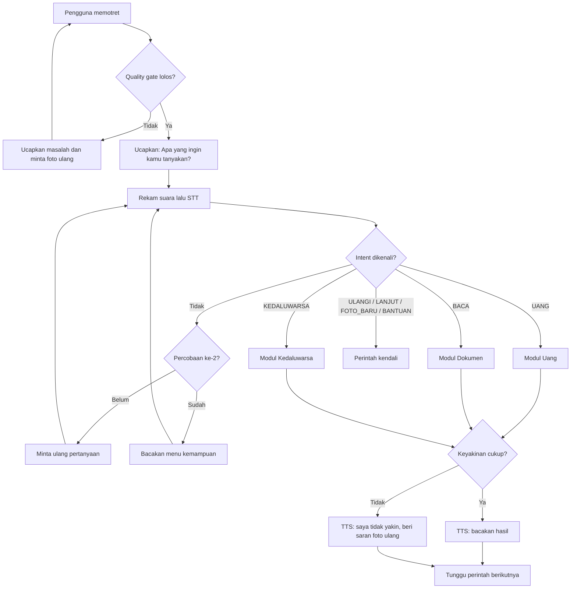
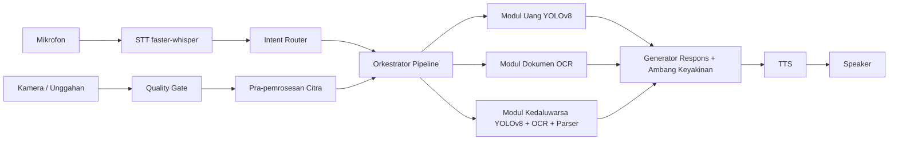

# SayIt: Dokumen Persyaratan Produk (PRD)

> Salinan per 17 September 2026. Versi utama ada di Claude Docs ("PRD SayIt v2.1"). Jika versi utama diubah, perbarui salinan ini.

**Nama Proyek:** SayIt, teknologi asistif berbasis Computer Vision dan pemrosesan suara
**Pengembang:** Tim Rekayasa Perangkat Lunak, IPB University
**Konteks:** Proyek mata kuliah Pengolahan Citra dan Visi Komputer
**Versi:** 2.1 (17 September 2026)
**Status:** Draf, menunggu persetujuan tim. Fase 0 selesai sebagian; model uang v2.1 dan modul suara sudah dibuat.

| Versi | Perubahan utama |
| :--- | :--- |
| 1.0 | Draf awal |
| 2.0 | Koreksi klaim offline, fitur merek dikeluarkan dari cakupan, intent routing berbobot dengan fallback, quality gate gambar, modul pra-pemrosesan citra, parser tanggal, ambang keyakinan, metrik evaluasi, struktur repositori, roadmap mingguan, daftar risiko |
| 2.1 | Hasil Fase 0 dan training model uang: skema 7 kelas, sumber dataset v2.1, STT faster-whisper small + prompt, TTS gTTS hibrida (klaim offline dan prinsip privasi direvisi), aturan router diperbarui, penyaringan kotak bersarang, hasil evaluasi sementara, struktur repo aktual, risiko baru |


## 1. Ringkasan

SayIt adalah prototipe teknologi asistif yang membantu penyandang disabilitas netra memperoleh informasi visual melalui interaksi suara dua arah. Pengguna memotret objek, mengajukan pertanyaan dengan suara, lalu menerima jawaban dalam bentuk suara.

Versi prototipe mendukung tiga kemampuan:

1. **Mengenali nominal uang kertas Rupiah** (termasuk menjumlahkan beberapa lembar).
2. **Membacakan tulisan** pada dokumen atau kertas.
3. **Membacakan tanggal kedaluwarsa** pada kemasan dan menyebutkan statusnya (masih berlaku atau sudah lewat).

Seluruh komponen menggunakan pustaka open-source dan **tidak bergantung pada API berbayar**. Pengenalan suara (STT) dan pemrosesan citra berjalan **offline di laptop**. Keluaran suara memakai **gTTS yang membutuhkan internet** (keputusan Fase 0, lihat Bagian 8.10). Dengan desain hibrida, jawaban uang dan tanggal tetap bisa diputar tanpa internet; hanya pembacaan isi dokumen yang wajib online.


## 2. Masalah, Tujuan, dan Cakupan

### 2.1 Masalah

Penyandang disabilitas netra kesulitan mengakses informasi visual sehari-hari, seperti nominal uang, isi surat, dan tanggal kedaluwarsa produk. Ada tantangan tambahan yang sering diabaikan: **pengguna netra tidak dapat memastikan objek berada di dalam bingkai kamera**, sehingga foto sering buram, gelap, atau terpotong. Sistem harus mampu mendeteksi kondisi ini dan memberi arahan, bukan diam-diam menghasilkan jawaban salah.

### 2.2 Tujuan

| Kode | Tujuan |
| :--- | :--- |
| G1 | Pengguna dapat mengetahui nominal dan total uang kertas dari satu foto |
| G2 | Pengguna dapat mendengar isi tulisan pada dokumen cetak |
| G3 | Pengguna dapat mengetahui tanggal kedaluwarsa dan statusnya |
| G4 | Sistem memberi umpan balik suara yang jelas saat foto tidak layak atau hasil tidak meyakinkan |

### 2.3 Di luar cakupan (versi prototipe)

- Deteksi keaslian atau uang palsu. **Sistem tidak memverifikasi keaslian uang** dan hal ini wajib disampaikan dalam dokumentasi pengguna.
- Uang logam (koin) dan mata uang asing.
- Pengenalan merek atau nama produk.
- Panduan pembidikan kamera secara real-time ("geser ke kiri").
- Aplikasi mobile native.
- Tulisan tangan.
- Bahasa selain Bahasa Indonesia.

Butir-butir di atas dicatat sebagai pengembangan lanjutan (Bagian 16).


## 3. Pengguna dan Batasan Prototipe

**Pengguna sasaran:** penyandang disabilitas netra (total atau low vision) yang terbiasa menggunakan perangkat dengan umpan balik suara.

**Batasan prototipe yang dinyatakan secara eksplisit:**

- Antarmuka Streamlit berbasis web **belum sepenuhnya ramah pembaca layar**. Tombol kamera dan mikrofon masih memerlukan klik, dan urutan fokus elemen tidak sepenuhnya terkendali. Prototipe ini ditujukan untuk memvalidasi pipeline, bukan sebagai produk akhir.
- Pengujian awal dilakukan oleh tim. Pengujian dengan penguji mata tertutup hanya merupakan **proksi** dan tidak mewakili pengalaman pengguna netra sesungguhnya. Pengujian dengan pengguna netra memerlukan persetujuan (informed consent) dan koordinasi dengan pihak terkait.


## 4. Prinsip Desain

1. **Suara adalah antarmuka utama.** Setiap status sistem (menunggu, memproses, gagal, selesai) diumumkan dengan suara.
2. **Lebih baik mengatakan "tidak yakin" daripada menebak.** Salah membaca tanggal kedaluwarsa obat atau nominal uang berdampak nyata. Hasil di bawah ambang keyakinan tidak dibacakan sebagai fakta.
3. **Offline sejauh mungkin, tanpa API berbayar.** Satu-satunya ketergantungan internet adalah sintesis suara untuk teks dinamis (isi dokumen).
4. **Privasi secara default.** Foto dan rekaman suara diproses di memori dan tidak disimpan, kecuali data uji yang dikumpulkan dengan persetujuan. **Pengecualian yang wajib diungkapkan:** teks yang dibacakan dengan gTTS (termasuk isi dokumen) dikirim ke server Google. Audio hasil sintesis teks dinamis tidak disimpan ke disk.
5. **Jawaban singkat dulu, detail menyusul.** Teks panjang dibacakan per bagian.


## 5. Alur Pengguna

### 5.1 Alur utama

1. Pengguna memotret objek.
2. **Quality gate** memeriksa foto (buram, gelap, terlalu terang, resolusi). Jika gagal, sistem menyebutkan masalahnya dan meminta foto ulang.
3. Sistem mengucapkan: *"Foto berhasil diambil. Apa yang ingin kamu tanyakan?"*
4. Pengguna mengajukan pertanyaan dengan suara.
5. STT mengubah suara menjadi teks.
6. **Intent router** menentukan modul yang sesuai. Jika tidak ada yang cocok, sistem menjalankan alur fallback.
7. Modul pemrosesan citra berjalan (dengan pra-pemrosesan).
8. Hasil diperiksa terhadap ambang keyakinan.
9. Jawaban dibacakan dengan TTS.
10. Pengguna dapat meminta *ulangi*, *lanjut*, *foto baru*, atau mengajukan pertanyaan lain tentang foto yang sama.

### 5.2 Diagram alur




## 6. Kebutuhan Fungsional

Prioritas: **W** = Wajib (MVP), **S** = Sebaiknya, **O** = Opsional.

| Kode | Kebutuhan | Prioritas |
| :--- | :--- | :---: |
| FR-01 | Sistem menerima foto dari kamera (webcam) dan dari unggahan file | W |
| FR-02 | Sistem menjalankan quality gate dan menyebutkan penyebab kegagalan | W |
| FR-03 | Sistem merekam suara dan mentranskripsikannya ke teks Bahasa Indonesia | W |
| FR-04 | Sistem mengklasifikasikan intent: UANG, BACA, KEDALUWARSA, ULANGI, LANJUT, FOTO_BARU, BANTUAN, TIDAK_DIKENALI | W |
| FR-05 | Sistem menjalankan fallback maksimal dua kali lalu membacakan menu kemampuan | W |
| FR-06 | Sistem mendeteksi nominal uang kertas Rupiah TE 2016 dan TE 2022 | W |
| FR-07 | Sistem menjumlahkan beberapa lembar uang dalam satu foto | W |
| FR-08 | Sistem membaca seluruh teks dokumen dengan urutan baca yang benar | W |
| FR-09 | Sistem membacakan teks panjang per bagian dengan perintah "lanjut" | S |
| FR-10 | Sistem mendeteksi area tanggal kedaluwarsa, memotongnya, dan membacanya dengan OCR | W |
| FR-11 | Sistem mengurai (parse) tanggal ke format baku dan menyebutkan status terhadap tanggal hari ini | W |
| FR-12 | Jika area kedaluwarsa tidak terdeteksi, sistem mencoba OCR seluruh gambar lalu parser tanggal | S |
| FR-13 | Sistem menolak menyampaikan hasil di bawah ambang keyakinan dan menggantinya dengan pesan "tidak yakin" | W |
| FR-14 | Sistem mengumumkan status "sedang memproses" jika proses lebih dari 2 detik | S |
| FR-15 | Sistem menyarankan modul lain jika modul terpilih tidak menemukan objek (misal: tidak ada uang, tetapi banyak teks) | O |
| FR-16 | Sistem mencatat log teknis (waktu proses, intent, skor) tanpa menyimpan foto dan audio | S |


## 7. Kebutuhan Non-Fungsional

| Kode | Kebutuhan | Target awal |
| :--- | :--- | :--- |
| NFR-01 | Latensi end-to-end (setelah pengguna selesai bicara sampai suara jawaban mulai) | ≤ 8 detik di laptop tanpa GPU |
| NFR-02 | Mode offline | Uang, kedaluwarsa, dan semua pesan tetap berjalan tanpa internet; baca dokumen menampilkan pesan "butuh internet" |
| NFR-03 | Privasi | Foto, rekaman, dan audio teks dinamis tidak ditulis ke disk saat penggunaan normal; pengiriman teks ke gTTS diungkapkan di dokumentasi |
| NFR-04 | Bahasa | Seluruh interaksi dalam Bahasa Indonesia |
| NFR-05 | Keterulangan | Lingkungan dapat dipasang ulang dari `requirements.txt` dan README |
| NFR-06 | Kejelasan suara | Kecepatan bicara TTS dapat diatur |

Target latensi bersifat awal dan direvisi setelah pengukuran baseline di Fase 0.


## 8. Arsitektur Sistem

### 8.1 Diagram komponen



### 8.2 Quality gate

Pemeriksaan dilakukan sebelum pemrosesan apa pun.

| Pemeriksaan | Metode | Ambang awal | Pesan suara |
| :--- | :--- | :--- | :--- |
| Buram | Variance of Laplacian pada citra grayscale | < 100 | "Foto terlihat buram. Coba pegang kamera lebih diam." |
| Terlalu gelap | Rata-rata intensitas grayscale | < 60 | "Foto terlalu gelap. Coba dekatkan ke lampu." |
| Terlalu terang | Rata-rata intensitas dan proporsi piksel jenuh | > 220 | "Foto terlalu terang atau silau. Coba ubah sudut kamera." |
| Resolusi | Sisi terpendek | < 480 piksel | "Resolusi foto terlalu kecil." |

**Semua ambang wajib dikalibrasi** menggunakan sampel foto tim pada Fase 0, karena nilainya sangat bergantung pada kamera dan skala gambar.

### 8.3 Pra-pemrosesan citra

Tahap ini merupakan inti materi Pengolahan Citra dan diterapkan secara berbeda per modul.

| Langkah | Teknik | Dipakai di |
| :--- | :--- | :--- |
| Normalisasi ukuran | Resize dengan mempertahankan rasio | Semua modul |
| Perbaikan kontras | CLAHE pada kanal L (ruang warna LAB) | Semua modul, terutama kondisi minim cahaya |
| Reduksi derau | Bilateral filter atau Non-Local Means | Dokumen, kedaluwarsa |
| Koreksi perspektif | Deteksi kontur tepi kertas (Canny + approxPolyDP) lalu perspective transform | Dokumen |
| Koreksi kemiringan | Estimasi sudut dari minAreaRect atau Hough Transform | Dokumen |
| Pembesaran crop | Upscale 2x dengan interpolasi cubic | Kedaluwarsa (hasil crop) |
| Binarisasi | Adaptive thresholding (Gaussian) | Kedaluwarsa, dokumen bila meningkatkan akurasi |
| Operasi morfologi | Closing/dilation untuk menyambung titik cetakan dot-matrix | Kedaluwarsa |

Setiap langkah harus dapat diaktifkan atau dinonaktifkan lewat konfigurasi agar **uji ablasi** (dengan vs tanpa pra-pemrosesan) dapat dilakukan pada Fase 4.

### 8.4 Speech-to-Text

- Mesin: **faster-whisper `small`**, CPU, `compute_type=int8` (keputusan Fase 0).
- Parameter: `language="id"`, `beam_size=5`, VAD filter aktif, dan `initial_prompt` berisi kata kunci domain. Prompt **wajib**: tanpa prompt WER naik dari 7–8% menjadi 27,5%.
- Rekaman diawali **bunyi bip**, karena pada Fase 0 banyak suku kata pertama terpotong ("olong", "Roduk", "apan").
- **Penjaga halusinasi:** segmen dengan `no_speech_prob` > 0,6 dibuang, dan transkrip yang berisi 4 kata prompt atau lebih secara berurutan dianggap kosong. Sisipan kata tunggal dari prompt masih bisa terjadi (contoh Fase 0: "tolong bacakan…" menjadi "uang, bacakan…") dan ditangani oleh bobot router.
- Model dimuat sekali saat aplikasi mulai.

### 8.5 Intent router

**Normalisasi:** huruf kecil, hapus tanda baca, rapikan spasi.

**Penilaian berbobot:** setiap intent memiliki kata kunci kuat (bobot 2) dan lemah (bobot 1). Daftar lengkap ada di `sayit/intent/keywords.py`; tabel berikut ringkasannya.

| Intent | Kata kunci kuat (bobot 2) | Kata kunci lemah (bobot 1) |
| :--- | :--- | :--- |
| KEDALUWARSA | kedaluwarsa (dan variasi ejaannya), expired, ekspayer, exp, best before, sampai kapan, basi, masih layak | tanggal, masih bisa dimakan, masih bisa diminum |
| UANG | uang, duit, nominal, rupiah, kembalian, pecahan | berapa, lembar, ribu |
| BACA | bacakan, tulisan, dokumen, surat, teks, membaca, tertulis | baca, isi, kertas |
| ULANGI | ulangi, sekali lagi, apa tadi, ulang lagi | – |
| LANJUT | lanjut, lanjutkan, berikutnya, selanjutnya | – |
| FOTO_BARU | foto lagi, foto ulang, ambil ulang, foto baru | – |
| BANTUAN | bantuan, bisa apa, bantu apa, cara pakai | – |

**Aturan pencocokan (diperbarui dari simulasi Fase 0):**

1. Akhiran -nya, -kah, dan -lah dipotong ("dokumennya" → "dokumen").
2. Dua kata berurutan juga dicoba sebagai satu kata ("di minum" → "diminum").
3. Fuzzy matching (`rapidfuzz`, skor ≥ 85) **hanya untuk kata kunci minimal 6 huruf**. Aturan awal yang lebih longgar membuat "uang" dianggap sama dengan "ulang".
4. Intent kendali hanya dicocokkan persis.

**Aturan keputusan:**

1. Pilih intent tugas (KEDALUWARSA, UANG, BACA) dengan skor tertinggi. Skor minimum = 2.
2. Jika skor seri, gunakan prioritas **KEDALUWARSA > UANG > BACA**.
3. Intent kendali hanya dipakai jika tidak ada intent tugas yang mencapai skor minimum.
4. Jika tidak ada yang mencapai skor minimum, intent = TIDAK_DIKENALI dan fallback berjalan.

**Hasil sementara:** 60 transkrip asli Fase 0 (small + prompt) dan 15 kalimat referensi terklasifikasi benar. Dari 27 kalimat baru yang ditulis setelah aturan disusun, 24 lolos pada putaran pertama; tiga kata kunci ("tertulis", "basi", "masih layak") lalu dinaikkan menjadi kuat. Karena aturan disetel pada data yang sama, akurasi ini **optimistis** dan wajib diuji ulang dengan penutur dan kalimat baru.

**Keterbatasan yang diketahui:** kalimat lintas-konteks seperti "berapa uang yang tertulis di surat ini" diarahkan ke BACA.

### 8.6 Modul uang

- **Model:** YOLOv8 (varian n atau s) hasil pelatihan kustom.
- **Kelas:** 7 kelas nominal (`1000` sampai `100000`). Skema 14 kelas per emisi dibatalkan karena dataset publik tidak membedakan emisi. Performa per emisi dilaporkan dari foto uji sendiri.
- **Model kerja:** v2.1 (lihat Bagian 10.1 dan 11.1).
- **Pasca-pemrosesan:**
  - Buang deteksi dengan skor < ambang (Bagian 8.9).
  - **Buang kotak bersarang:** kotak yang minimal 85% luasnya berada di dalam kotak lain berkelas sama dianggap bagian dari uang yang sama. Aturan ini juga dipakai saat menyusun dataset, karena sebagian anotasi publik memberi kotak terpisah untuk potret dan angka nominal.
  - Jika dua kotak dengan kelas berbeda saling tumpang tindih (IoU > 0,5), tandai hasil sebagai tidak yakin.
  - Hitung jumlah per nominal dan total.
- **Konversi angka ke kata:** modul sendiri `sayit/response/terbilang.py` yang menghasilkan token kata, agar setiap kata bisa diputar dari klip suara tersimpan.
- **Contoh respons:** *"Terdeteksi tiga lembar: dua lembar lima puluh ribu rupiah dan satu lembar sepuluh ribu rupiah. Totalnya seratus sepuluh ribu rupiah."*
- **Batasan yang dinyatakan:** lembaran yang bertumpuk rapat atau tertutup sebagian besar dapat tidak terhitung. Pengguna disarankan meletakkan uang terpisah.

### 8.7 Modul dokumen

1. Pra-pemrosesan dokumen (koreksi perspektif, kemiringan, kontras).
2. OCR seluruh gambar.
3. Buang kata dengan skor keyakinan rendah.
4. Urutkan kotak teks dari atas ke bawah, kiri ke kanan, lalu kelompokkan menjadi baris dan paragraf.
5. Bagi teks menjadi potongan sekitar 40 kata.
6. Bacakan potongan pertama, lalu ucapkan: *"Katakan 'lanjut' untuk bagian berikutnya."*

### 8.8 Modul kedaluwarsa

1. YOLOv8 mendeteksi `expired_date_zone`.
2. Crop berdasarkan bounding box dengan margin 10%.
3. Pra-pemrosesan crop (upscale, CLAHE, binarisasi, morfologi).
4. OCR pada crop. Jika gagal, coba ulang dengan crop tanpa binarisasi.
5. Parser tanggal (8.8.1).
6. Jika zona tidak terdeteksi: OCR seluruh gambar lalu parser tanggal (FR-12), dengan respons yang menyebutkan bahwa hasil kurang pasti.

#### 8.8.1 Parser tanggal

- **Format yang didukung minimal:** `DD/MM/YYYY`, `DD-MM-YY`, `DD.MM.YYYY`, `YYYY.MM.DD`, `MM/YY`, `MM YYYY`, `DD MMM YYYY`, dengan nama bulan Indonesia dan Inggris (JAN, FEB, MAR, APR, MEI/MAY, JUN, JUL, AGU/AUG, SEP, OKT/OCT, NOV, DES/DEC).
- **Koreksi karakter OCR yang umum:** O→0, I/l→1, S→5, B→8, hanya di dalam kandidat tanggal.
- **Asumsi urutan:** format Indonesia (hari sebelum bulan) sebagai default.
- **Tanggal tanpa hari** (misalnya `12/2027`) ditafsirkan sebagai akhir bulan tersebut, dan respons menyebut "berlaku sampai Desember 2027".
- **Validasi:** tanggal harus valid di kalender dan berada dalam rentang wajar (misalnya 5 tahun ke belakang hingga 10 tahun ke depan).
- **Beberapa tanggal ditemukan** (misalnya tanggal produksi dan kedaluwarsa):
  1. Prioritaskan tanggal yang berdekatan dengan penanda EXP, ED, BB, BEST BEFORE, KEDALUWARSA, "baik digunakan sebelum".
  2. Jika tidak ada penanda, pilih tanggal terakhir dan nyatakan kurang yakin.
  3. Jika masih ambigu, bacakan keduanya.
- **Status:** dibandingkan dengan tanggal sistem. Contoh: *"Tanggal kedaluwarsa 3 Desember 2026. Produk masih berlaku, sisa 78 hari."* atau *"Produk sudah melewati tanggal kedaluwarsa sejak 5 hari lalu."*
- **Wajib memiliki unit test** untuk setiap format.

### 8.9 Ambang keyakinan dan templat respons

| Komponen | Ambang awal | Jika di bawah ambang |
| :--- | :--- | :--- |
| Deteksi uang (YOLO) | skor ≥ 0,50 | "Saya tidak yakin dengan nominal uang ini. Coba foto ulang dengan uang terbuka penuh." |
| Deteksi zona kedaluwarsa | skor ≥ 0,40 | Jalankan fallback OCR seluruh gambar |
| OCR per kata | skor ≥ 0,40 | Kata dibuang |
| Hasil parser tanggal | tanggal valid dan lolos rentang | "Saya menemukan tulisan, tetapi tidak yakin itu tanggal kedaluwarsa. Tulisannya: ..." |
| Transkripsi STT | teks kosong atau terlalu pendek | "Maaf, suaramu tidak terdengar jelas. Coba ulangi." |

Ambang dikalibrasi menggunakan set validasi pada Fase 4. Prinsipnya, untuk uang dan kedaluwarsa, **presisi lebih diutamakan daripada recall**.

### 8.10 Text-to-Speech

- **Mesin:** gTTS (`lang="id"`), dipilih tim setelah uji dengar Fase 0. MMS-TTS Indonesia dinilai tidak jelas, dan suara bawaan Windows di laptop tim hanya tersedia dalam bahasa Inggris.
- **Desain hibrida** (`sayit/audio/tts.py`). Setiap respons disusun dari tiga jenis bagian:

| Bagian | Sumber | Butuh internet saat dipakai? |
| :--- | :--- | :--- |
| Klip | 65 file MP3 (kalimat tetap, frasa penyusun, kata angka, nama bulan) yang dibuat sekali oleh `scripts/build_tts_cache.py` | Tidak |
| Jeda | Hening 250 ms (koma) atau 450 ms (titik) | Tidak |
| Teks dinamis | gTTS saat itu juga, disimpan hanya di folder sementara | Ya. Tanpa internet diganti pesan "butuh internet" |

- Respons uang dan tanggal hanya memakai klip dan jeda, sehingga tetap berjalan offline.
- Isi dokumen dibacakan per bagian (sekitar 40 kata) agar suara pertama cepat keluar.
- **Risiko:** gTTS bukan API resmi Google dan dapat berubah tanpa pemberitahuan; latensi bergantung pada jaringan (1,87 detik per kalimat saat Fase 0).


## 9. Spesifikasi Teknologi

| Komponen | Pilihan | Status | Catatan |
| :--- | :--- | :--- | :--- |
| Bahasa | Python 3.11 | Ditetapkan | Dipasang lewat Python Install Manager (`py install 3.11`) |
| Pengolahan citra | OpenCV (`opencv-python`), NumPy | Ditetapkan | Quality gate dan pra-pemrosesan |
| Deteksi objek | YOLOv8 (`ultralytics`) varian n/s | Ditetapkan | Lisensi AGPL-3.0, aman untuk tugas akademik |
| OCR | EasyOCR (default) vs PaddleOCR | Diputuskan di Fase 0 | Benchmark pada 30 gambar sampel |
| STT | `faster-whisper` small, CPU int8, dengan prompt | Ditetapkan (Fase 0, 1 penutur) | WER 7–8%, latensi median 1,4 s di i7-13650HX |
| TTS | `gTTS` (hibrida dengan klip tersimpan) | Ditetapkan (uji dengar tim) | Butuh internet untuk teks dinamis; MMS-TTS dan suara Windows gugur |
| Intent | Aturan berbobot + `rapidfuzz` | Ditetapkan | |
| Angka ke kata | Modul sendiri `terbilang.py` | Ditetapkan | Menghasilkan token untuk klip suara |
| Audio I/O | `sounddevice`, `soundfile` | Ditetapkan | `soundfile` membaca MP3 gTTS |
| Antarmuka | Streamlit (`st.camera_input`, `st.audio_input`, `st.file_uploader`, `st.audio` autoplay) | Ditetapkan | Verifikasi versi Streamlit yang mendukung komponen ini |
| Anotasi | Roboflow | Ditetapkan | Ekspor format YOLOv8 |
| Pelatihan | Google Colab (GPU T4) | Ditetapkan | Simpan checkpoint ke Google Drive |
| Pengujian kode | `pytest` | Ditetapkan | Terutama parser tanggal dan intent router |
| Versi kode | Git + GitHub | Ditetapkan | Branch per fitur, pull request direview anggota lain |


## 10. Dataset

### 10.1 Dataset uang Rupiah (YOLOv8)

**Dataset yang dipakai (v2.1):**

| Sumber | Jumlah | Catatan |
| :--- | ---: | :--- |
| Dataset B (Roboflow, fork) | 1.125 foto | Bersih: 875 gambar satu-objek 100% cocok dengan nominal di nama file; 203 kotak bagian uang dibuang; didominasi emisi 2022 |
| Dataset A (`deteksi-rupiah-jkkmu`, fork) | 56 foto berlabel + 13 latar | Hanya gambar yang nominalnya tertulis di nama file, dengan label diambil dari nama file |
| COCO128 | 120 foto | Contoh latar tanpa uang |

**Dataset A tidak dipakai secara utuh** karena: (1) sebagian label tertukar secara sistematis (contoh: uang 100.000 berlabel 5000, 50.000 berlabel 100000); (2) 1.334 gambar hanya berasal dari 600 foto asli dengan 3 salinan augmentasi; (3) 227 foto asli muncul di lebih dari satu split. Skor mAP 0,947 yang diperoleh dari dataset ini tidak valid dan tidak dilaporkan sebagai performa.

**Kekurangan yang harus ditutup dengan foto sendiri:** emisi 2016, foto berisi 2–5 lembar, dan foto tanpa uang dengan latar realistis. Lisensi dataset B belum dicatat dan wajib dicek.

**Pedoman untuk foto tambahan:**

- **Objek:** uang kertas TE 2016 dan TE 2022, nominal 1.000 sampai 100.000, **sisi depan dan belakang**.
- **Jumlah minimum:** 30–50 foto per nominal, diprioritaskan emisi 2016.
- **Variasi wajib:** pencahayaan terang/redup/lampu kuning, latar belakang beragam, uang terlipat, miring, sebagian tertutup jari, beberapa lembar dalam satu foto, jarak dekat dan jauh, beberapa model ponsel.
- **Gambar negatif:** sekitar 10% gambar tanpa uang (dompet kosong, struk, kertas biasa) agar model tidak mudah salah deteksi.
- **Dataset publik** (misalnya di Roboflow Universe) boleh dipakai sebagai tambahan setelah lisensi dan kualitas labelnya diperiksa.
- **Anotasi:** satu bounding box per lembar, menutupi seluruh bagian lembaran yang terlihat. Jangan memberi kotak terpisah untuk potret atau angka nominal.

### 10.2 Dataset zona kedaluwarsa (YOLOv8)

- **Objek:** area cetakan tanggal kedaluwarsa pada kemasan makanan, minuman, dan obat, termasuk cetakan dot-matrix, inkjet, dan emboss.
- **Jumlah minimum:** 400 foto dari berbagai produk.
- **Label tunggal:** `expired_date_zone`.
- **Pedoman anotasi:** kotak mencakup satu baris yang memuat tanggal kedaluwarsa, termasuk penanda seperti "EXP" jika berada di baris yang sama. Kode produksi di baris terpisah tidak dimasukkan.

### 10.3 Set uji tambahan (tanpa pelatihan)

| Set | Isi | Jumlah minimum | Label kebenaran |
| :--- | :--- | :--- | :--- |
| Uji tanggal | Foto kemasan yang tidak dipakai saat pelatihan | 100 | Tanggal diketik manual |
| Uji dokumen | Foto dokumen cetak **dummy** (bukan dokumen pribadi) | 30 | Teks lengkap |
| Uji perintah suara | Rekaman pertanyaan dari minimal 5 penutur, termasuk kondisi bising | 100 | Transkrip dan intent |
| Uji intent (teks) | Kalimat pertanyaan, termasuk kalimat ambigu dan di luar cakupan | 150 | Intent |

### 10.4 Aturan pembagian data dan etika

- Rasio train/val/test: **70/20/10**.
- **Pembagian berdasarkan objek fisik, bukan per foto.** Lembar uang atau kemasan yang sama tidak boleh muncul di train dan test sekaligus, agar skor tidak menggelembung karena kebocoran data.
- Augmentasi (rotasi, kecerahan, blur, noise) hanya diterapkan pada data train.
- Rekaman suara hanya diambil dari penutur yang memberi persetujuan.
- Dokumen uji tidak boleh berisi data pribadi asli.


## 11. Metrik Evaluasi dan Target

| Komponen | Metrik | Target awal |
| :--- | :--- | :--- |
| YOLO uang | mAP@0.5 dan mAP@0.5:0.95, precision/recall per kelas, confusion matrix | mAP@0.5 ≥ 0,85 |
| YOLO zona kedaluwarsa | mAP@0.5, recall | mAP@0.5 ≥ 0,75 |
| Total uang per foto | Akurasi exact match total nominal | ≥ 85% |
| OCR dokumen | Character Error Rate (CER) | ≤ 15% |
| Tanggal kedaluwarsa end-to-end | Akurasi exact match tanggal | ≥ 70% |
| STT | Word Error Rate (WER) pada set perintah | ≤ 25% |
| Intent router | Akurasi dan confusion matrix | ≥ 90% |
| Sistem | Latensi end-to-end (median dan p90) | Median ≤ 8 detik |
| Pengujian pengguna (proksi) | Tingkat keberhasilan tugas dan kuesioner SUS | Keberhasilan ≥ 80% |

**Uji ablasi yang direncanakan:**

1. OCR dengan vs tanpa pra-pemrosesan (dokumen dan kedaluwarsa).
2. EasyOCR vs PaddleOCR (jika waktu memungkinkan setelah Fase 0).
3. Ukuran model Whisper: akurasi vs latensi.

Target di atas adalah target awal dan dapat direvisi setelah baseline diukur, dengan alasan yang dicatat di laporan.

### 11.1 Hasil sementara (17 September 2026)

| Komponen | Hasil | Status terhadap target | Catatan |
| :--- | :--- | :--- | :--- |
| YOLO uang v2.1 | mAP@0.5 0,966; mAP@0.5:0.95 0,959 | Lolos | Test berasal dari sumber yang sama dengan data latih, sehingga optimistis. Baseline v1 pada test yang sama: 0,330 |
| Total uang per foto | 96,1% (122/127); foto dari dataset B 98,1%; foto emisi 2016 dari dataset A 4/7 | Lolos, dengan catatan | Emisi 2016 lemah; foto berisi banyak lembar hanya 1 sampel |
| STT (small + prompt) | WER 7,2% dan 8,2% (2 run); tenang 5–6%, bising 9–10% | Lolos | Baru 1 penutur yang sudah tahu kalimatnya |
| Latensi STT | Median 1,4 s, p90 1,4 s | Lolos | Laptop i7-13650HX, 20 GB RAM; laptop lain perlu diukur |
| Intent router | Lihat Bagian 8.5 | Lolos, optimistis | Perlu set uji baru |
| TTS | gTTS 1,87 s per kalimat; MMS-TTS 1,51 s tetapi tidak jelas | Keputusan tim | Butuh internet untuk teks dinamis |


## 12. Struktur Repositori

Status 17 September 2026: modul bertanda (✓) sudah dibuat dan diuji dengan `pytest` (172 tes).

```
sayit/
├── app.py                    # Antarmuka Streamlit
├── requirements.txt          # ✓
├── README.md                 # ✓
├── assets/tts/               # ✓ klip suara hasil scripts/build_tts_cache.py
├── config/
│   └── settings.yaml         # ✓ ambang, parameter STT/TTS/router
├── docs/
│   └── keputusan-teknis.md   # ✓ catatan keputusan
├── fase0/                    # ✓ skrip dan hasil uji STT/TTS
├── scripts/
│   ├── build_tts_cache.py    # ✓
│   └── demo_voice.py         # ✓ demo alur suara tanpa kamera
├── sayit/
│   ├── config.py             # ✓
│   ├── pipeline.py           # Orkestrator
│   ├── audio/
│   │   ├── io.py             # ✓ rekam (dengan bip) dan putar
│   │   ├── stt.py            # ✓
│   │   └── tts.py            # ✓
│   ├── intent/
│   │   ├── keywords.py       # ✓
│   │   └── router.py         # ✓
│   ├── vision/
│   │   ├── quality_gate.py
│   │   ├── preprocess.py
│   │   ├── money.py
│   │   ├── document.py
│   │   ├── expiry.py
│   │   └── date_parser.py
│   └── response/
│       ├── terbilang.py      # ✓ angka ke kata
│       └── templates.py      # ✓ kalimat respons
├── models/                   # best_money.pt, best_expiry.pt (tidak di-commit jika besar)
├── notebooks/
│   ├── 01_train_money_baseline.ipynb   # ✓ baseline + audit dataset
│   ├── 02_money_v2_1_build_and_train.ipynb  # ✓ dataset v2.1 + training
│   ├── 03_train_expiry.ipynb
│   └── 04_ocr_benchmark.ipynb
├── eval/
│   ├── eval_detection.py
│   ├── eval_ocr.py
│   ├── eval_stt.py
│   ├── eval_intent.py
│   └── eval_latency.py
├── data/
│   └── test_sets/            # Label set uji (tanpa data pribadi)
└── tests/
    ├── data/fase0_transkrip_small.csv  # ✓
    ├── test_router.py        # ✓
    ├── test_stt.py           # ✓
    ├── test_tts.py           # ✓
    ├── test_templates.py     # ✓
    ├── test_terbilang.py     # ✓
    ├── test_date_parser.py
    └── test_quality_gate.py
```


## 13. Roadmap

Asumsi: durasi 12 minggu. Jadwal disesuaikan setelah tenggat resmi dan jumlah anggota tim dikonfirmasi.

| Fase | Minggu | Kegiatan | Keluaran | Kriteria selesai |
| :--- | :---: | :--- | :--- | :--- |
| **0. Persiapan dan uji teknis** | 1 | Buat repo dan lingkungan; uji faster-whisper Bahasa Indonesia; uji kandidat TTS; benchmark EasyOCR vs PaddleOCR pada 30 gambar; kalibrasi awal quality gate; tulis pedoman anotasi | Repo berjalan, catatan keputusan teknis | Semua butir di Bagian 15 terjawab |
| **1. Data dan pelatihan** | 2–5 | Kumpulkan foto (minggu 2–3), anotasi di Roboflow (minggu 3–4), latih YOLOv8 di Colab (minggu 4–5), evaluasi awal | `best_money.pt`, `best_expiry.pt`, laporan mAP | Target mAP awal tercapai atau alasan kegagalan terdokumentasi |
| **2. Modul pipeline** (paralel dengan Fase 1) | 2–6 | STT dan TTS (minggu 2); intent router + unit test (minggu 3); quality gate + pra-pemrosesan (minggu 4); modul dokumen + parser tanggal (minggu 5); integrasi model YOLO (minggu 6) | Pipeline berjalan dari command line | Satu foto + satu pertanyaan menghasilkan jawaban suara untuk ketiga intent |
| **3. Antarmuka** | 7–8 | Aplikasi Streamlit, alur suara otomatis, unggahan foto, pengumuman status | Prototipe web | Alur lengkap bisa didemokan tanpa membuka terminal |
| **4. Evaluasi dan perbaikan** | 9–10 | Kumpulkan set uji; jalankan semua skrip evaluasi dan ablasi; kalibrasi ambang; perbaiki kelemahan terbesar; uji pengguna proksi | Tabel hasil evaluasi, analisis kesalahan | Semua metrik di Bagian 11 terukur |
| **5. Dokumentasi dan demo** | 11–12 | Laporan akhir, README, video demo, slide presentasi | Paket pengumpulan | Semua dokumen siap dikumpulkan |

**Status per 17 September 2026:**
- Fase 0: STT dan TTS selesai diuji (1 penutur); OCR, Streamlit, dan webcam belum.
- Fase 1: model uang v2.1 selesai dari dataset publik; dataset kedaluwarsa belum dicari.
- Fase 2: modul STT, TTS, router, dan templat respons selesai beserta 172 unit test; modul citra belum.

**Titik keputusan penting:**

- **Akhir minggu 1:** stack TTS, OCR, dan ukuran Whisper final.
- **Akhir minggu 5:** jika mAP uang jauh di bawah target, tambah data pada kelas terlemah sebelum melanjutkan, alih-alih menambah epoch.
- **Akhir minggu 8:** fitur dibekukan (feature freeze). Setelah ini hanya perbaikan bug dan evaluasi.


## 14. Risiko dan Mitigasi

| Risiko | Dampak | Mitigasi |
| :--- | :--- | :--- |
| TTS bergantung pada internet (terjadi: gTTS dipilih) | Tinggi | Desain hibrida: uang, tanggal, dan pesan tetap memakai klip tersimpan |
| gTTS berhenti bekerja atau diblokir | Sedang | Klip tersimpan tetap berfungsi; siapkan mesin cadangan bila terjadi |
| Isi dokumen pribadi terkirim ke Google | Tinggi (privasi) | Diungkapkan di dokumentasi; jangan menguji dengan dokumen asli; audio dinamis tidak disimpan |
| Label dataset publik salah (terjadi pada dataset A) | Tinggi | Audit label, cek nominal di nama file, galeri potongan per kelas, cek kebocoran per foto asal |
| Model lemah pada emisi 2016 dan banyak lembar | Tinggi | Foto tambahan yang diprioritaskan; laporkan per emisi |
| Whisper menyisipkan kata dari prompt | Sedang | Penjaga halusinasi di `stt.py`, bobot router |
| OCR gagal membaca cetakan dot-matrix | Tinggi | Pra-pemrosesan morfologi, upscale, fallback beberapa varian crop, respons "tidak yakin" |
| Pengumpulan data uang memakan waktu lama | Tinggi | Dataset publik dipakai dulu (v2.1); foto sendiri difokuskan pada celah yang terukur |
| Kebocoran data antara train dan test | Sedang | Pembagian per objek fisik (Bagian 10.4) |
| Sesi Colab terputus | Sedang | Simpan checkpoint ke Google Drive setiap beberapa epoch |
| Whisper salah mentranskripsikan kata serapan | Sedang | `initial_prompt`, fuzzy matching, daftar variasi ejaan |
| Latensi terlalu tinggi di CPU | Sedang | Model YOLO varian n, Whisper lebih kecil, muat model sekali saat aplikasi mulai |
| Autoplay audio diblokir browser | Rendah | Uji di browser target; sediakan tombol putar sebagai cadangan |
| Pengguna mengira sistem mendeteksi uang palsu | Tinggi (keselamatan) | Pernyataan eksplisit di dokumentasi dan pesan bantuan |


## 15. Asumsi Teknis yang Wajib Diverifikasi di Fase 0

| No | Asumsi | Status |
| :--- | :--- | :--- |
| 1 | Kualitas dan latensi faster-whisper | **Terjawab sebagian:** small + prompt memenuhi target, tetapi baru 1 penutur. Perlu penutur lain dan laptop anggota lain |
| 2 | Suara Bahasa Indonesia offline | **Terjawab:** suara Windows hanya Inggris, MMS-TTS tidak jelas → gTTS |
| 3 | Lisensi model TTS | **Terjawab:** gTTS (pustaka MIT, memakai layanan Google); MMS-TTS CC-BY-NC tidak dipakai |
| 4 | EasyOCR vs PaddleOCR | Belum |
| 5 | Dukungan Streamlit untuk audio dan kamera | Belum |
| 6 | Resolusi webcam untuk dokumen | Belum |
| 7 | Dataset uang publik | **Terjawab:** tersedia, tetapi dataset A bermasalah; lisensi dataset B belum dicatat |

Hasil verifikasi dicatat di `docs/keputusan-teknis.md` beserta tanggal dan alasannya.


## 16. Pengembangan Lanjutan

- Panduan pembidikan kamera secara real-time.
- Aplikasi mobile native dengan dukungan pembaca layar (TalkBack/VoiceOver).
- Pengenalan uang logam dan fitur keamanan uang.
- Pengenalan merek dan nama produk.
- Model bahasa lokal untuk pemahaman pertanyaan yang lebih bebas.


## 17. Pembagian Peran

| Peran | Tanggung jawab | Anggota |
| :--- | :--- | :--- |
| Data & Model | Pengumpulan data, anotasi, pelatihan dan evaluasi YOLO | (diisi) |
| Pipeline & Citra | Quality gate, pra-pemrosesan, OCR, parser tanggal, orkestrator | (diisi) |
| Audio & Antarmuka | STT, TTS, intent router, Streamlit | (diisi) |
| QA & Dokumentasi | Set uji, skrip evaluasi, laporan, README | (diisi) |

Pengumpulan data adalah tanggung jawab bersama seluruh anggota pada minggu 2–3.
